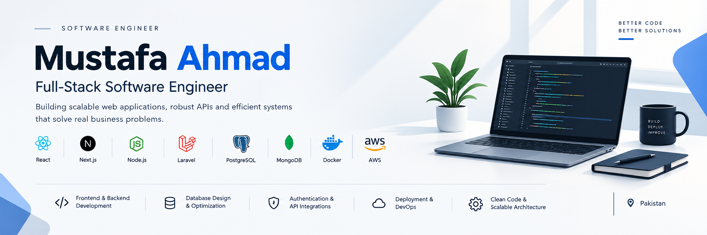

<!-- ========================= HEADER ========================= -->

  

  

  
  
  

---

## About Me

I'm a **Full-Stack Software Engineer with 4+ years of experience** building web applications, backend services, REST APIs, and database-driven business solutions. I work across the software development lifecycle—from data modeling and business logic to frontend implementation, third-party integrations, and production deployment.

I focus on **clean, maintainable code, practical problem-solving, and reliable software** that delivers real business value.

- **Role:** Full-Stack Software Engineer
- **Location:** Pakistan
- **Core focus:** Web application development, backend engineering, REST APIs, database design, and deployment
- **Email:** [mustafahmad030@gmail.com](mailto:mustafahmad030@gmail.com)

## Technical Skills

### Backend & Languages

  

### Frontend

  

### Databases & ORM

  
  

### Cloud, Deployment & Tools

  
  

### Additional Technologies

  

## Engineering Focus

| Area | What I Work On |
|---|---|
| **Full-Stack Development** | Building end-to-end web applications with maintainable architecture and clear separation of concerns |
| **Backend & API Engineering** | REST APIs, business logic, request validation, reusable services, and error handling |
| **Database Engineering** | Schema design, relationships, and working with SQL and NoSQL databases |
| **Authentication & Security** | Authentication, authorization, input validation, and API protection |
| **Third-Party Integrations** | External APIs, webhooks, notification services, and messaging integrations |
| **Deployment & Operations** | Linux servers, Nginx/Apache, PM2, environment configuration, and application hosting |

## GitHub Analytics

  
  

  

## Beyond Code

When I'm away from the keyboard, I enjoy playing **cricket** and **table tennis**.

---

  <strong>Let's connect and build something useful.</strong> 
  <a href="https://www.linkedin.com/in/mustafahmad/">LinkedIn</a> ·
  <a href="mailto:mustafahmad030@gmail.com">Email</a> ·
  <a href="https://stackoverflow.com/users/22007794">Stack Overflow</a>

  

